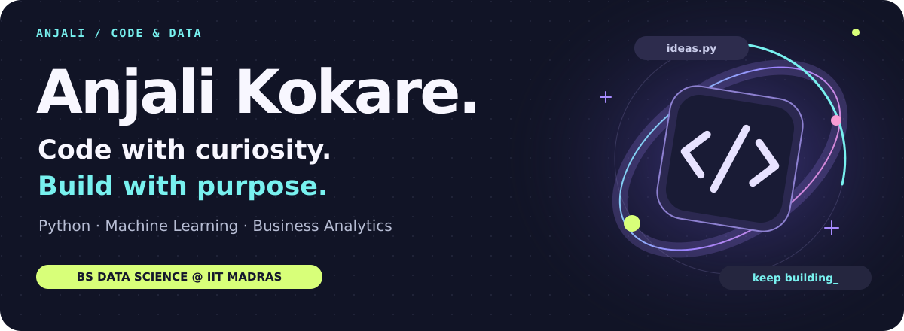
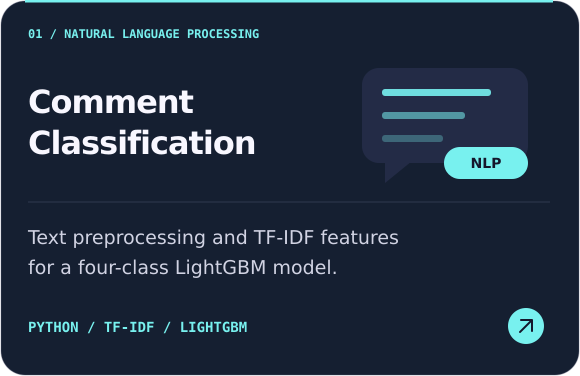
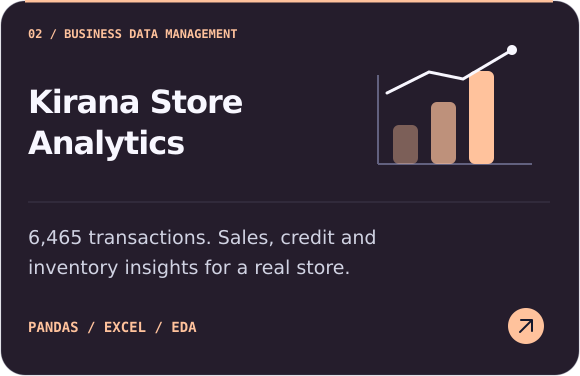
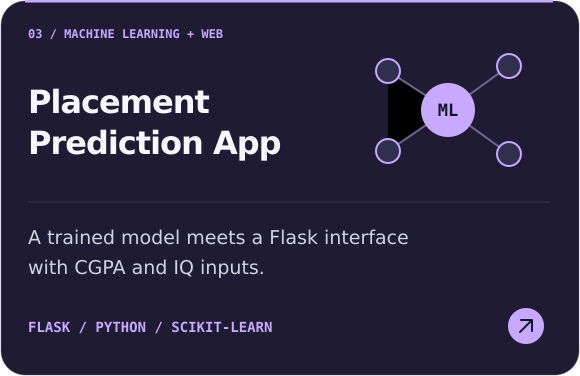
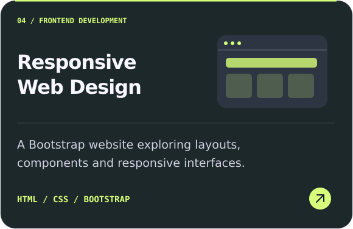
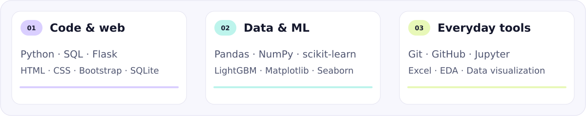
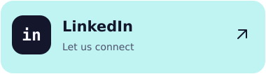
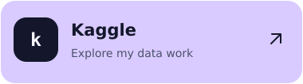
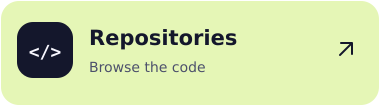

<!-- Original SVG artwork is stored in this repository. No external stats widgets required. -->

  

  <a href="#about-me"><b>About</b></a> &nbsp; / &nbsp;
  <a href="#selected-work"><b>Selected work</b></a> &nbsp; / &nbsp;
  <a href="#my-toolkit"><b>Toolkit</b></a> &nbsp; / &nbsp;
  <a href="#lets-connect"><b>Connect</b></a>

## About me

Hi, I'm **Anjali** — a **BS Data Science student at IIT Madras**, currently at the diploma level. I enjoy building with Python, exploring machine learning, and finding useful stories in real business data.

My projects connect three interests: **clean code, thoughtful analysis, and applications people can use.**

- **Building:** Python and Flask applications, from inputs to predictions.
- **Exploring:** NLP, feature engineering, model workflows and data visualization.
- **Learning by doing:** turning coursework and experiments into documented projects.

## Selected work

Explore a few projects that bring those interests together. Click a card to see the repository.

  
  

  
  

<b>More from my learning lab</b> — notebooks, coursework and experiments

| Collection | What you will find |
| --- | --- |
| [MLP material](https://github.com/anjalirameshwarkokare/MLP-material) | Machine learning practice material and notebook examples |
| [MLP lectures](https://github.com/anjalirameshwarkokare/MLP-lectures) | Lecture notebooks and concepts I am working through |
| [IITM TDS coursework](https://github.com/anjalirameshwarkokare/iitm-tds-26t1) | Coursework and technical exercises |

## My toolkit

I use these tools across coursework and personal projects, and keep improving through practice.

## Let's connect

I'm interested in **Python development, data analytics and ML opportunities**, and conversations with people who enjoy building useful things.

  
  
  

Curious by nature. Better with every iteration.

