<!-- Custom original vector artwork. All graphics live in this repository. -->

  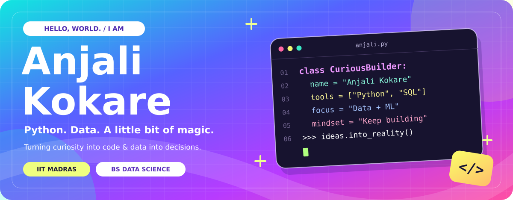

  <a href="#selected-work">Selected work</a> &nbsp; · &nbsp;
  <a href="#developer-toolkit">Developer toolkit</a> &nbsp; · &nbsp;
  <a href="#lets-connect">Let's connect</a>

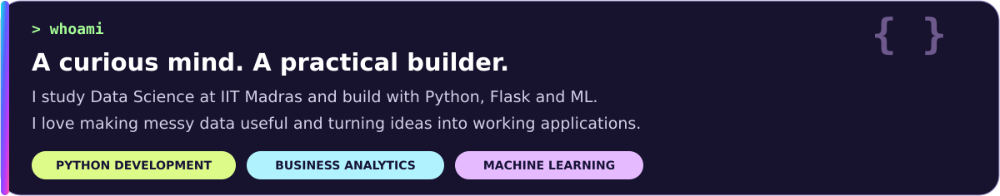

<strong>Learning by doing. Building with curiosity. Improving one commit at a time.</strong>

<h2 id="selected-work">Selected work</h2>

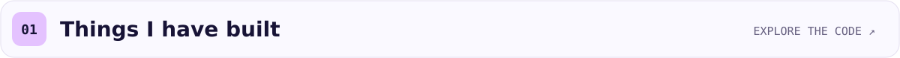

  <a href="https://github.com/anjalirameshwarkokare/comment-category-prediction">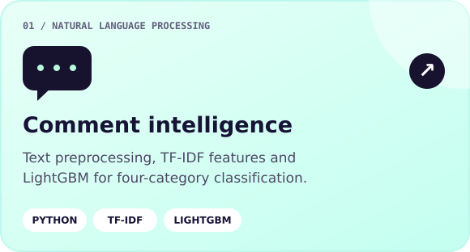</a>
  <a href="https://github.com/anjalirameshwarkokare/BDM_Capstone_project_kirana-store">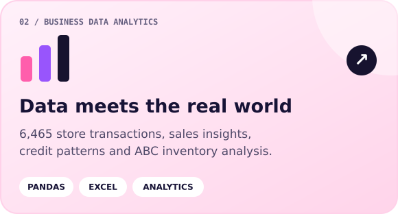</a>

  <a href="https://github.com/anjalirameshwarkokare/ML-placement-app">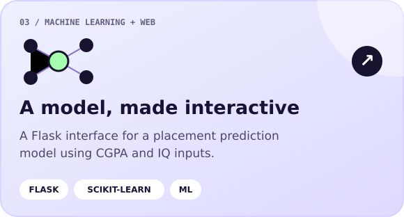</a>
  <a href="https://github.com/anjalirameshwarkokare/MLP-material">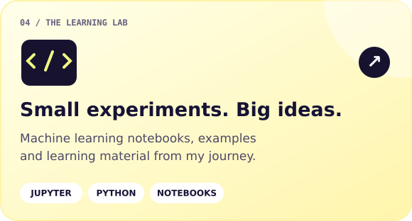</a>

**More of my work:** [ML lecture notebooks](https://github.com/anjalirameshwarkokare/MLP-lectures) · [Bootstrap website](https://github.com/anjalirameshwarkokare/codebootstrap)

<h2 id="developer-toolkit">Developer toolkit</h2>

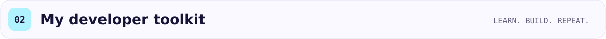
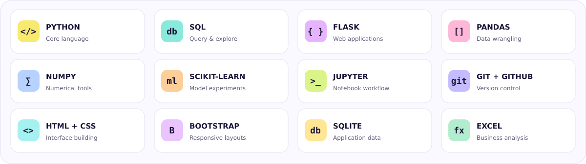

### What keeps me curious

- **Python development** — building useful applications with clear, readable code.
- **Data and business analytics** — finding patterns that lead to practical decisions.
- **Machine learning** — exploring text classification, prediction and model workflows.

<h2 id="lets-connect">Let's connect</h2>

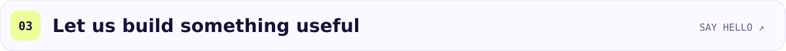

  <a href="https://www.linkedin.com/in/anjali-kokare-645488382/">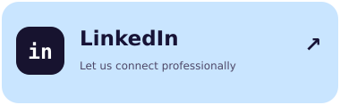</a>
  <a href="https://www.kaggle.com/anjalikokare">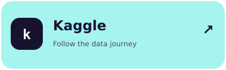</a>
  <a href="https://github.com/anjalirameshwarkokare?tab=repositories">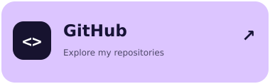</a>

Open to conversations about Python, data projects, machine learning and thoughtful collaboration.

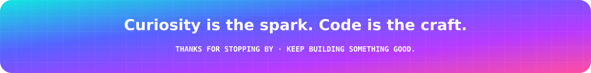
